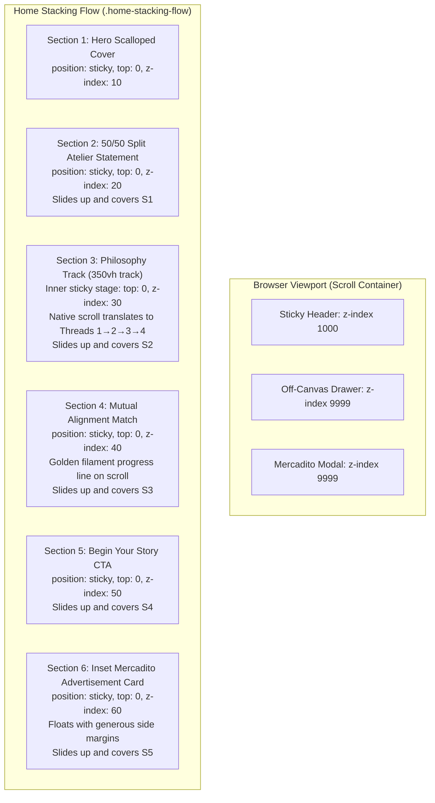

## Goal Capsule

- **Objective:** Deliver a completely cohesive, luxury web experience for Paula Macouzet Weddings where all interactions (off-canvas menu, sequential Philosophy scroll, section stacking curtain transitions, and Match timeline) work reliably without jank, and El Mercadito displays as an inset editorial advertisement.
- **Means:** Fix the critical JavaScript syntax error that blocked script execution, implement a native scroll-driven sticky track for the 4-step Philosophy threads, configure pure CSS sticky card stacking across all sections, and style El Mercadito as an inset framed promotional card (KTD1, KTD2, KTD3, KTD4).
- **Authority hierarchy:** User explicit directives (stacking sheet effect across all sections, inset advertisement frame for Mercadito, smooth sequential Philosophy threads, no photo placeholders yet) outrank defaults.
- **Stop conditions:** Zero JavaScript errors in console, menu drawer opens and closes smoothly, Philosophy transitions through steps 1-4 naturally on scroll and via step dots, sections stack seamlessly with subtle drop shadows, Match timeline fills dynamically, and El Mercadito renders as an inset card with side margins.

---

## Product Contract

### Summary
The weddings home experience currently feels fragmented ("parchada") due to broken scripts and mismatched layout modes. This plan restores interaction reliability, unifies the visual identity with a cohesive design system, implements the luxury sheet stacking transitions between all sections, replaces brittle wheel-hijacking with native scroll in Philosophy, and reframes El Mercadito as an inset editorial advertisement card with side margins.

### Problem Frame
During recent restructuring, three distinct failure modes occurred:
1. A JavaScript syntax error at line 653 (`timelineProgress.style.height = ;`) halted script parsing, silently breaking the navigation drawer, the philosophy controls, and the match timeline.
2. The section stacking effect was only partially applied to the hero section (`.sheet-hero`), while subsequent sections remained in standard flow, breaking the visual illusion of stacked sheets of fine archival paper.
3. The Philosophy threads attempted to hijack the mouse wheel via `e.preventDefault()`, which creates trackpad inertia traps, while El Mercadito was rendered as an edge-to-edge section rather than an intentional, inset editorial advertisement.

### Requirements

#### Interactive Reliability & Navigation
- R1. The off-canvas navigation menu drawer must open smoothly from the left when clicking `— MENU`, display all destination links with elegant typography, and close via the close button, clicking the backdrop, or pressing Escape.
- R2. The Philosophy section must present 4 sequential threads ("01 Your Roots", "02 Your Shared Story", "03 The Soul of the Land", and "04 The Convergence: Your Unique Story") where botanical illustration layers cross-fade progressively, fully navigable via natural vertical scrolling as well as interactive step dots and prev/next buttons.
- R3. The Match timeline ("We Are a Good Match If...") must animate smoothly as the user scrolls into view, progressively filling the golden filament line and revealing nodes without blocking or freezing page scroll.
- R4. The El Mercadito modal must open upon clicking "Explore El Mercadito" in the spotlight card and close cleanly without trapping scroll.

#### Section Architecture & Editorial Design
- R5. All major sections on the Home page must follow the sticky card stacking curtain effect: as the user scrolls, each subsequent section must slide up from the bottom and cover the preceding section like stacked sheets of archival paper.
- R6. The Art & Curated Welcome Market ("El Mercadito") section must be styled as an inset editorial advertisement card with generous side margins and gold hairline border, looking like a featured promotional insert rather than a full-bleed page section.
- R7. Visual identity must be strictly unified across all sections: haute-couture typography (`Cinzel` for headings and monograms, `Poppins` for body and navigation), consistent palette (`#1a1817`, `#b89d74`, `#fcfbfa`, `#eee9e6`), and consistent button components (`btn-pill-dark`, `btn-pill-outline`, `btn-solid-dark`).
- R8. Solid `#eee9e6` color placeholders must be maintained for visual media until photography is explicitly supplied.

### Scope Boundaries
- **In Scope:** `weddings/index.html`, `weddings/style.css`, and core shared interaction scripts.
- **Deferred to Follow-Up Work:** Applying the stacking card layout to subpages (`collections`, `stories`, `objects`, `for-planners`, `inquire`) once the Home page architecture is verified and approved.
- **Outside Product Identity:** Stock photography, generic web templates, or intrusive scroll-hijacking libraries.

---

## Planning Contract

### Key Technical Decisions

- KTD1. **Script Engine Repair & Defensive Event Binding:**
  - *(session-settled: user-directed — chosen over leaving scripts broken: immediate resolution of syntax error at line 653 and isolation of event listeners)*.
  - Fix the empty assignment `timelineProgress.style.height = `${progressPct}%`;` and wrap section initialization in clean modules so an issue in one feature cannot break the navigation drawer or modal.

- KTD2. **Native Scroll-Driven Sticky Track for Philosophy:**
  - *(session-settled: user-directed — chosen over wheel-event hijacking: native scroll ensures 100% smooth trackpad inertia and touch compatibility)*.
  - Structure the Philosophy section as an outer scroll track (`min-height: 350vh`) with an inner sticky stage (`position: sticky; top: 0; height: 100vh; overflow: hidden;`).
  - As the user scrolls naturally through this track, the scroll progress percentage automatically drives the active step (0-25% = step 1, 25-50% = step 2, 50-75% = step 3, 75-100% = step 4 with convergence golden glow).
  - Clicking step dots or Prev/Next buttons smoothly scrolls the browser to the exact vertical offset of that step.

- KTD3. **Pure CSS Stacking Cards Architecture:**
  - *(session-settled: user-directed — chosen over partial hero-only sticky: entire page sections stack like archival sheets)*.
  - The main container `.home-stacking-flow` has standard flow with no `overflow: hidden` on parent elements.
  - Each `.home-sheet-section` receives:
    ```css
    position: sticky;
    top: 0;
    min-height: 100vh;
    background-color: #ffffff;
    box-shadow: 0 -25px 60px rgba(26, 24, 23, 0.08);
    ```
  - Ascending `z-index` ladder:
    - Hero (`#hero-cover`): `z-index: 10; background-color: #fcfbfa;`
    - Split Statement (`#studio-statement`): `z-index: 20;`
    - Philosophy Track (`#philosophy-track`): `z-index: 30;`
    - Mutual Match (`#match`): `z-index: 40;`
    - Final CTA Journey (`#begin-journey`): `z-index: 50;`
    - Inset Mercadito Ad (`#welcome-market`): `z-index: 60;`

- KTD4. **Inset Editorial Advertisement Frame for El Mercadito:**
  - *(session-settled: user-directed — chosen over full-bleed section: user explicitly requested an inset rectangle with side margins)*.
  - Transform `.sheet-mercadito` into a centered, floating editorial card:
    - Container: `max-width: 1080px; margin: 4rem auto; padding: 4rem 3.5rem;`
    - Border: `1px solid rgba(184, 157, 116, 0.4);`
    - Background: `#fcfbfa; box-shadow: 0 20px 50px rgba(0,0,0,0.04); border-radius: 8px;`
    - Visual layout: Side-by-side editorial text and solid `#eee9e6` media box with "ATELIER SPECIAL EXTENSION" badge.

- KTD5. **Drawer & Modal Z-Index Isolation:**
  - Ensure `.luxury-sidebar-drawer` has `z-index: 9999` and backdrop `z-index: 9998` so they render strictly above all sticky stacking cards (`z-index: 10..60`) and the sticky top header (`z-index: 1000`).

---

## High-Level Technical Design



---

## Implementation Units

### U1. Script Engine Repair & Off-Canvas Menu Robustness
- **Goal:** Fix the JavaScript syntax error in `weddings/index.html` and ensure the off-canvas navigation drawer opens and closes flawlessly with full keyboard accessibility.
- **Requirements:** R1, R7.
- **Files:** `weddings/index.html`, `weddings/style.css`.
- **Approach:**
  1. Fix line 653 syntax error in `weddings/index.html`: `timelineProgress.style.height = `${progressPct}%`;`.
  2. Verify `#luxury-menu-trigger` click listener correctly adds `.is-open` to `.luxury-sidebar-drawer` and `.luxury-drawer-backdrop`.
  3. Ensure `z-index` layering: drawer (`z-index: 9999`), backdrop (`z-index: 9998`), header (`z-index: 1000`).
  4. Ensure backdrop click, close button click, and Escape key cleanly dismiss the drawer and restore document scroll.
- **Test Scenarios:**
  - Click `— MENU` button: drawer slides in from the left, backdrop darkens.
  - Click `CLOSE ×` or backdrop: drawer slides out, backdrop fades.
  - Press `Escape`: drawer closes immediately.
  - Verify zero console errors upon initial page load.
- **Verification:** Browser console reports 0 errors; menu toggles smoothly in browser test.

---

### U2. Pure CSS Stacking Curtain Architecture
- **Goal:** Configure seamless sticky card stacking transitions between all sections on the Home page.
- **Requirements:** R5, R7.
- **Files:** `weddings/style.css`, `weddings/index.html`.
- **Approach:**
  1. Remove any `overflow: hidden` or height locks on `body`, `.home-body`, or `.home-stacking-flow`.
  2. Apply `position: sticky; top: 0; min-height: 100vh;` to all `.home-sheet-section` elements.
  3. Set distinct ascending `z-index` values (10, 20, 30, 40, 50, 60) and top box shadows (`box-shadow: 0 -25px 50px rgba(26, 24, 23, 0.07);`).
  4. Ensure each section has an opaque background (`#ffffff` or `#fcfbfa`) so underlying sections are completely covered when obscured.
- **Test Scenarios:**
  - Scroll from Hero to Section 2: Section 2 rises smoothly from bottom and cleanly covers Hero like a fresh archival sheet.
  - Scroll from Section 2 to Philosophy: Philosophy rises and cleanly covers Section 2.
  - Scroll through all sections: each subsequent section stacks cleanly over the previous.
- **Verification:** Continuous scroll test reveals no visual overlapping glitches or layout jumping.

---

### U3. Native Scroll-Driven 4-Step Philosophy Experience
- **Goal:** Replace brittle wheel-hijacking with a native scroll-driven sticky track for the 4-step Philosophy threads, supporting mouse wheel, trackpad inertia, mobile touch, and step dot clicks.
- **Requirements:** R2, R7, R8.
- **Files:** `weddings/index.html`, `weddings/style.css`.
- **Approach:**
  1. Wrap Philosophy in an outer track `#philosophy-track` with `height: 360vh; position: relative;`.
  2. Set the inner stage `.philosophy-stage-wrap` to `position: sticky; top: 0; height: 100vh; display: flex; align-items: center; justify-content: center; overflow: hidden;`.
  3. Remove the broken `window.addEventListener('wheel', ...)` with `e.preventDefault()`.
  4. Attach a lightweight scroll observer / `requestAnimationFrame` handler that reads the track's scroll progress:
     - 0.00 to 0.25: Step 1 (Roots)
     - 0.25 to 0.50: Step 2 (Shared Story)
     - 0.50 to 0.75: Step 3 (Soul of the Land)
     - 0.75 to 1.00: Step 4 (The Convergence: Your Unique Story — golden illumination)
  5. Cross-fade botanical SVG layers (`#layer-roots`, `#layer-story`, `#layer-land`, `#layer-convergence`) and update thread text cards with smooth opacity and transform transitions.
  6. Enable clicking step dots and Next/Prev buttons to smoothly scroll the window to the corresponding track offset (`window.scrollTo({ top: targetY, behavior: 'smooth' })`).
- **Test Scenarios:**
  - Natural scroll down: Thread 1 smoothly transitions to Thread 2, then Thread 3, then Thread 4 with golden convergence glow.
  - Natural scroll up: Threads reverse smoothly.
  - Click Step Dot 3: Section smoothly transitions to Thread 3 and highlights layer 3.
  - Click "Next Thread": Advances to next thread.
  - On Step 4, clicking "Next Section ↓" scrolls past the track to Section 4.
- **Verification:** Trackpad scrolling inside Philosophy feels completely natural with no locking or stuck state.

---

### U4. Seamless Match Timeline Golden Filament Fill
- **Goal:** Ensure "We Are a Good Match If..." animates smoothly without blocking scroll, progressively illuminating the golden filament and revealing the 4 criteria nodes.
- **Requirements:** R3, R7.
- **Files:** `weddings/index.html`, `weddings/style.css`.
- **Approach:**
  1. Fix the calculation of `timelineProgress.style.height`: dynamically compute the percentage from the revealed items or scroll progress through the card.
  2. Use IntersectionObserver with multiple thresholds (0.2, 0.5, 0.8) to progressively reveal each `.match-timeline-item` with subtle upward fade.
  3. Ensure `.match-conclusion-badge` illuminates with golden border and emblem once all 4 items are in view.
- **Test Scenarios:**
  - Scroll into Match section: Node 1 appears, golden line extends down to Node 1.
  - Continue scrolling: Nodes 2, 3, 4 sequentially reveal as golden line fills to 100%.
  - Conclusion seal fades in with CTA "Begin the Conversation →".
- **Verification:** Timeline reveals progressively and smoothly without stutter.

---

### U5. Inset Editorial Advertisement Styling for El Mercadito
- **Goal:** Redesign the Art & Welcome Market section into an elegant, inset promotional card with generous side margins, distinct from standard full-bleed sections.
- **Requirements:** R6, R7, R8.
- **Files:** `weddings/index.html`, `weddings/style.css`.
- **Approach:**
  1. Refactor `#welcome-market` wrapper: center-aligned with `max-width: 1080px; margin: 4rem auto;`.
  2. Style `.mercadito-promo-card`:
     - Hairline border: `1px solid rgba(184, 157, 116, 0.4)`.
     - Background: `#fcfbfa` on top of section background.
     - Subtle shadow: `box-shadow: 0 20px 45px rgba(26, 24, 23, 0.05)`.
     - Inner padding: `4rem 3.5rem`.
     - Corner radius: `8px`.
  3. Layout: Two-column responsive grid with editorial copy, "ATELIER SPECIAL EXTENSION" badge, "Explore El Mercadito →" button, and solid `#eee9e6` media placeholder.
  4. Ensure modal trigger opens `#mercadito-modal` smoothly.
- **Test Scenarios:**
  - Verify visually that El Mercadito has prominent side margins and clearly looks like an editorial advertisement insert.
  - Click "Explore El Mercadito →": modal opens with full details of mezcal keepsakes, café, Purépecha textiles, and copper.
  - Click modal close button: modal closes smoothly.
- **Verification:** Visual confirmation in browser demonstrates an intentional, floating promotional card.

---

## Verification Contract

- **Test Commands & Checks:**
  1. Browser Console Verification: Inspect browser logs to ensure 0 errors/warnings on load and during interactions.
  2. Interactive Flow Test via Browser Subagent:
     - Load `http://localhost:5173/weddings/`.
     - Click `#luxury-menu-trigger` -> assert drawer `.is-open` and backdrop visible.
     - Click `#drawer-close-btn` -> assert drawer closed.
     - Scroll down page -> assert sticky sheet stacking transitions between sections.
     - Scroll into Philosophy -> assert step 1 -> step 2 -> step 3 -> step 4 transition smoothly.
     - Test step dot navigation in Philosophy.
     - Scroll into Match section -> assert filament fills and items reveal.
     - Scroll to El Mercadito -> assert inset card format with side margins.
     - Click "Explore El Mercadito" -> assert modal opens and closes.

---

## Definition of Done

- All 5 Implementation Units completed.
- JavaScript syntax error resolved; 0 console errors.
- Menu drawer opens and closes properly.
- All page sections exhibit the cohesive sticky card stacking transition.
- Philosophy sequential scroll functions smoothly via native scroll and button controls.
- Match section timeline animates cleanly without scroll lock.
- El Mercadito displays as a framed inset advertisement card with side margins.
- Clean git commits on `feature/weddings-rebrand-restructure`.
